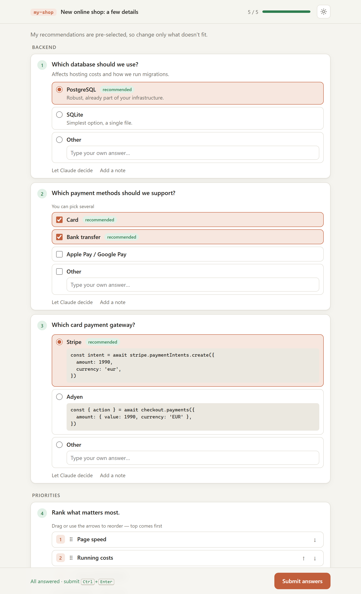

# ask-form

Answer Claude's clarifying questions in **one browser form** instead of the terminal.

When Claude Code needs to ask you many questions at once, a long list in the terminal is hard to read and harder to answer — and `AskUserQuestion` holds at most 4 questions. **ask-form** is a Claude Code skill that puts all the questions on one local web page, waits until you submit, and hands the answers back to Claude.

<picture>
  <source media="(prefers-color-scheme: dark)" srcset="docs/screenshot-dark.png">
  
</picture>

## Features

- **All questions on one page** with a progress bar, grouped into sections
- **Claude's recommendations pre-selected** — often you just confirm
- Question types: single choice, multiple choice, free text, **ranking** (drag & drop) and **scale** (e.g. 1–5)
- **Conditional questions** — follow-ups appear only when they apply
- **Previews** on options — code snippets, file trees or ASCII mockups to compare variants
- "Other" with your own answer, an optional note on every question, and **"Let Claude decide"**
- Optional questions (e.g. "Anything else?")
- Light / dark theme following your system, with a manual switch
- A project label in the header, so forms from parallel Claude sessions are easy to tell apart
- Plays a short sound when a form opens; <kbd>Ctrl</kbd>+<kbd>Enter</kbd> submits
- Private by design: the server runs only on `127.0.0.1`, with a random port and a secret token; nothing leaves your machine
- No dependencies — just Python 3.8+ (standard library)

## How it works

1. Claude writes its questions to a JSON file and starts a tiny local server in the background.
2. The form opens in your browser.
3. You submit; the server writes the answers and exits — Claude Code notifies Claude automatically, no typing in the terminal.

## Install

### As a Claude Code plugin (recommended)

```
/plugin marketplace add tomasfiala555/ask-form
/plugin install ask-form@ask-form
```

### Manually

Copy the skill folder into your personal skills:

```sh
git clone https://github.com/tomasfiala555/ask-form.git
cp -r ask-form/skills/ask-form ~/.claude/skills/
```

Restart Claude Code (or start a new session) afterwards.

### Make Claude use it reliably (optional)

The skill triggers on its own when Claude has more than 4 questions, but you can make it a firm rule by adding this to `~/.claude/CLAUDE.md`:

```markdown
When you need more than 4 clarifying questions, or questions that don't fit AskUserQuestion
(free text, more than 4 options, longer context), use the `ask-form` skill: all questions at once
in a browser form. Don't list them in the terminal or split them over several AskUserQuestion rounds.
```

## What it runs

ask-form is a skill with no MCP servers and no hooks, but it **does run local code**: the skill tells Claude to run the bundled script `skills/ask-form/scripts/ask-form.sh` through Claude Code's Bash tool. That launcher only picks a working Python 3 and starts `ask_form.py` (Python standard library only, no packages are installed).

The script:

1. reads the questions file Claude wrote,
2. starts a local HTTP server on `127.0.0.1` with a random port and a secret per-form token,
3. opens the form in your default browser and plays a short system sound,
4. waits for you to submit, writes the answers to a local JSON file, prints a summary and exits (or exits after 2 hours without answers).

It goes through Claude Code's normal permissions, so you see and approve the command like any other Bash command. Nothing else is executed, nothing runs in the background after the form closes, and the full source is in [`skills/ask-form/scripts/`](skills/ask-form/scripts/).

## Privacy

ask-form sends **no data anywhere**. There is no telemetry, no analytics and no remote server.

- **Network:** the form server listens only on `127.0.0.1` (your own machine), on a random port, and accepts requests only with a secret per-form token. The page loads no external resources (no CDNs, fonts or scripts).
- **Files it reads and writes** (all local):
  - the questions file Claude writes (in its session scratchpad or a temp directory),
  - your answers, saved next to it as `<questions>.answers.json`,
  - your theme choice (light / dark / system) in `~/.claude/ask-form/prefs.json`.
- **Who sees your answers:** only Claude Code on your machine, which passes them to Claude in your current session, the same way it would pass answers you type in the terminal.

## Requirements

- [Claude Code](https://claude.com/claude-code)
- Python 3.8+ (`python3` or `python` on `PATH`)
- Tested on Windows (Git Bash) and WSL2 (the form opens in the Windows browser via localhost forwarding). Linux should work the same; macOS is untested.

## Question format

See [`skills/ask-form/SKILL.md`](skills/ask-form/SKILL.md) for the full JSON format Claude uses — question types, recommendations, conditional questions, previews and the answer format.

## License

[MIT](LICENSE)
